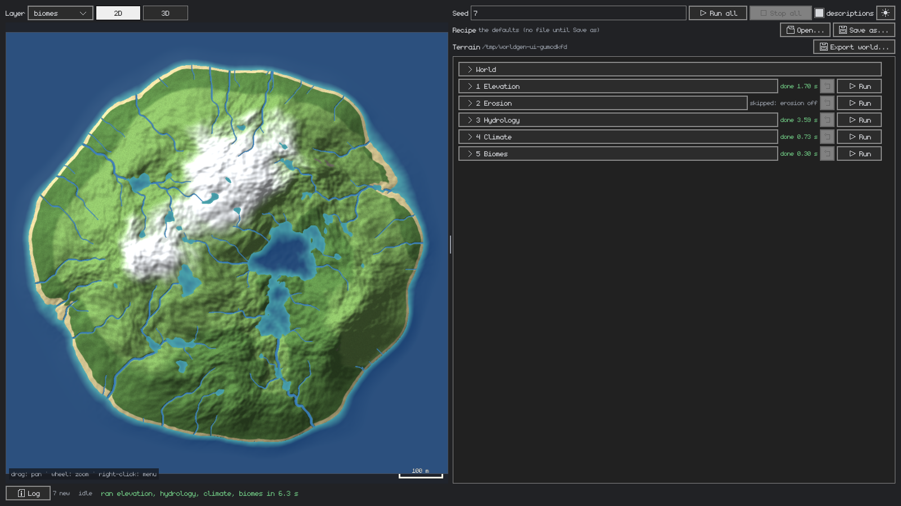
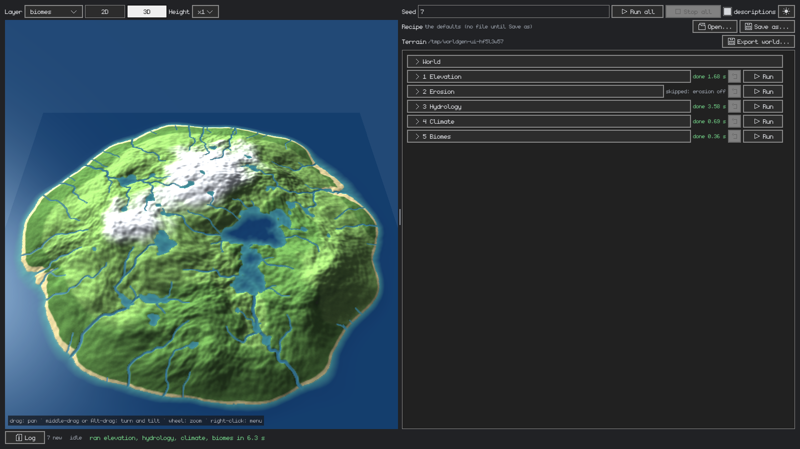

# worldgen

Generic procedural terrain generation, offline, from a YAML recipe and a seed: elevation, erosion,
hydrology, climate and biomes, written out as a compact terrain bundle, with a UI to tune it.

Everything is in metres. Terrains start at (0, 0) in the north-west corner; x runs east, z runs south
and y points up. The same recipe and seed always give the same terrain, byte for byte.

## How a terrain is made

Five stages run in order, each reading what the stages before it made. Each draws its random numbers
from its own stream, so tuning one stage never reshuffles another's.

1. **Elevation** — the base heightfield. Fractal (fBm) gradient noise, sampled through a domain warp so
   ridges and coasts bend, shaped by a land mask: one island, an archipelago, or a continent that runs
   out to the edges (or sinks them into the sea when the recipe sets `falloff`). A mask is not an image
   to draw or upload: an island is a radial falloff into the sea with a noise-bent outline, tuned by
   recipe keys (`mask_falloff`, `mask_distortion`, the archipelago's island count, size and spacing), so
   it lives in the recipe — stored, loaded and edited with it, in the UI as plain form fields. Optional
   mountain ranges rise where a slow mask puts them (ridged multifractal noise, after Musgrave's
   [*Texturing and Modeling: A Procedural Approach*](https://www.csee.umbc.edu/~ebert/book/book.html),
   with sharp crests), and optional terraces gather heights into strata. The noise is implemented here
   rather than taken from a library, so a terrain never changes with a dependency upgrade.
2. **Erosion** — weathering, when the recipe turns it on. Simulated droplets cut gullies and valleys
   and leave sediment where they slow, following [Beyer 2015, *"Implementation of a method for
   hydraulic erosion"*](docs/research/implementation%20of%20a%20methode%20for%20hydraulic%20erosion.pdf),
   batched for numpy and run from coarse grids to the full one so the valleys are mountain-sized, not
   rills. Then loose ground slides until no slope is steeper than it holds (talus
   and rock angles), after [Musgrave, Kolb and Mace 1989, *"The synthesis and rendering of eroded
   fractal terrains"*](https://doi.org/10.1145/74333.74337).
3. **Hydrology** — lakes and rivers. Depressions fill to their spill height (priority-flood,
   [Barnes et al. 2014](https://doi.org/10.1016/j.cageo.2013.04.024)) and the deep and wide ones
   become lakes; rain falls (less in the lee of ridges), flows downhill over D8 with a meander noise so
   rivers wiggle and gather, and where enough water gathers a river carves its channel and banks.
4. **Climate** — temperature (base, latitude, lapse rate over height, plus noise), moisture (rain and
   water nearby, plus noise), and slope.
5. **Biomes** — each cell's biome from rules tried in order over elevation, temperature, moisture,
   slope, sediment, relief and water (`sea`/`lake`/`river`/none); the last rule is the catch-all.
   Range edges soften into ramps so neighbouring biomes blend their ground colours, and a per-cell
   jitter keeps the ground from reading flat.

## Install

```sh
uv sync
```

## Generate a world

With the CLI, into `out/` by default:

```sh
uv run worldgen --seed 7                                     # the bundled default recipe, into out/seed-7
uv run worldgen --config examples/archipelago.yaml --seed 42 --out out/archipelago
uv run worldgen --seed 7 --preview-only --out .              # just preview.png
```

With the UI, to tune a recipe stage by stage and watch each one land:

```sh
uv run worldgen-ui                                       # from the defaults
uv run worldgen-ui --config examples/archipelago.yaml --seed 3 --run-all
```

The recipe as forms on the right, the terrain on the left as it stands after each stage, in 2D or 3D. A
layer dropdown switches the map between the heightfield, the land, mountain and terrace masks, erosion's
changes and sediment, the water, the climate and the biomes; hovering a cell reads out what lies under
it. **Export world...** writes the terrain bundle. Opening a bundle's `terrain.yaml` as a recipe also
brings its seed.





From Python:

```python
from worldgen import TerrainConfig, generate_terrain, export_terrain

config = TerrainConfig()  # the defaults; or load_config("examples/archipelago.yaml")
terrain = generate_terrain(config, seed=7)   # stages 1-5 in memory
export_terrain(terrain, "out/island")        # write the bundle
```

Either way the result is a self-contained **terrain bundle**:

```
out/island/
  terrain.yaml   # the recipe, the seed, and the worldgen version that wrote it
  terrain.npz    # the arrays, compressed deterministically
  preview.png    # shaded biome & water preview
```

## Load and use a world

`TerrainData` is the class for a bundle on disk:

```python
from worldgen import TerrainData

terrain = TerrainData.load("out/island")

terrain.elevation      # (N+1)² vertex grid, metres
terrain.water          # (N+1)² water surface, NaN = dry
terrain.biome          # N² cell grid, index into terrain.config.biomes.rules
terrain.color          # N² × 3 uint8 ground colours
terrain.slope          # derived, computed on first use: degrees per cell
terrain.relief         # derived: metres above the lowest ground within biomes.relief_radius
terrain.biome_weights  # derived: (rules, N, N) shares of each biome per cell
terrain.lakes          # the lake records: level, bounds, outlet, area
terrain.rivers         # the river polylines, vertex coordinates, source first

# What lies at a world point (x, z), in metres:
terrain.height_at(x, z)  # ground height, interpolated as the meshes interpolate it
terrain.water_at(x, z)   # water surface, NaN where dry
terrain.biome_at(x, z)   # the cell's biome id
```

### Patches

For a game that loads the world a piece at a time, read the terrain in patches of
`world.patch_cells` cells. There are no patch files on disk: the bundle stores one heightmap for the
whole world (`elevation` in `terrain.npz`), and a patch is an exact slice of it, cut on demand — the
heightmap with a one-vertex apron (so meshed patches meet without a seam), the water grids, the
per-cell grids, and the lakes and rivers that reach it:

```python
terrain = TerrainData.load("out/island")
nx, nz = terrain.patch_shape            # how many patches along x and z
patch = terrain.patch_at(500.0, 300.0)  # the patch under this point (metres); or terrain.patch((px, pz))
patch.elevation     # (P+3)² with apron; patch.vertex_height is the (P+1)² heightmap
patch.water         # (P+1)², NaN = dry — plus sea, lake_id, river, flow_dir
patch.biome         # P² — plus color, temperature, moisture, sediment
patch.lakes         # the lake records whose bounds reach the patch
patch.rivers        # the river polylines (world vertex coordinates) passing through it
mesh = patch.mesh() # terrain and water meshes, ready for worldgen.mesh.gpu's GpuPatch
```

`examples/generate.py` shows the whole flow: generate, export, load, take the patch under a point and
draw it in a window.

### What's in terrain.npz

Whole-terrain arrays, not patch files — patches are exact slices of these, cut on demand. For a world
of `N` cells per side (`world.size_cells`):

| Entry | Shape | Type | Meaning |
|---|---|---|---|
| `elevation` | (N+1)² | float64 | ground height, metres — the heightmap |
| `water` | (N+1)² | float64 | water surface height, `NaN` where dry |
| `sea` | (N+1)² | bool | open sea |
| `lake_id` | (N+1)² | uint16 | lake number, 0 = none |
| `river` | (N+1)² | uint8 | river strength, 0 = none |
| `flow_dir` | (N+1)² | uint8 | D8 flow direction code |
| `biome` | N² | uint8 | biome index per cell, into `biomes.rules` in terrain.yaml |
| `color` | N²×3 | uint8 | ground colour per cell |
| `temperature` | N² | float32 | °C |
| `moisture` | N² | float32 | 0–1 |
| `sediment` | N² | float32 | metres of sediment left by erosion |
| `meta` | — | JSON | lakes (id, level, bbox, outlet, area) and rivers (polylines of vertex coordinates) |

Vertex grids are (N+1)² because they store the corners of the N² cells. `slope`, `relief` and
`biome_weights` are not stored: they are pure functions of the stored arrays, recomputed exactly on
first use.

A `.npz` is a zip of `.npy` files, so plain numpy reads it, no worldgen needed:

```python
import json
import numpy as np

with np.load("out/island/terrain.npz") as data:
    elevation = data["elevation"]
    meta = json.loads(str(data["meta"]))  # {"lakes": [...], "rivers": [...]}
```

## Recipes

A recipe is YAML: the `world` grid (size, patch and cell size, sea level) and one section per stage.
Every key takes its default when left out, so a recipe says only what it changes.
[`assets/recipes/default.yaml`](assets/recipes/default.yaml), the recipe the CLI falls back on, lists
every key at its default, with a comment per key.

See `examples/` for recipes that change a little, and `worldgen.generator.config` for the prose
documentation of every field.

`version` records the worldgen version that wrote the file, stamped on every export. worldgen never
checks it: whether a bundle written by another version still works for you is your call as the client.
But when reading a bundle does fail, the error names the version in its file.

## Project structure

One package, `worldgen`, under `src/`:

- `worldgen/generator/` — the offline generator: `terrain.yaml` + seed → elevation, water, biomes, lakes
  and rivers. `config.py` is the recipe (`TerrainConfig`, the `world` grid plus one section per stage),
  `pipeline.py` runs the stages in order, `stages/` holds one module per stage (`elevation`, `erosion`,
  `hydrology`, `climate`, `biomes`), `noise.py` and `grid.py` the array helpers they share. `terrain.py`
  is the terrain in memory, `terrain_io.py` the bundle on disk (`generate_terrain`, `export_terrain`,
  `load_terrain`), `patches.py` reading a terrain in patches, `preview.py` the hillshaded preview and the
  deterministic file writers, `__main__.py` the `worldgen` CLI.
- `worldgen/mesh/` — terrain and water meshes: `builders.py` builds them as pure numpy arrays (so they
  run on worker threads), `overview.py` downsamples the whole terrain to a low resolution for the 3D view
  and height queries, `gpu.py` uploads the arrays to raylib (main thread only). Nothing here loads saved
  worlds.
- `worldgen/viewer/` — the terrain renderer the UI's 3D view uses: `render.py` (the terrain and water
  shaders, bundled in `viewer/shaders/`), `config.py` (`ViewerSettings`, from `VIEWER_*` environment
  variables), `camera.py` (the free-flying camera), `geometry.py` (camera maths, no window).
- `worldgen/ui/` — the generator with a UI (`worldgen-ui`), as MVC. `model/` has no raylib and is tested
  without a window: `model/recipe/` is the draft recipe being edited (the forms built from the pydantic
  classes, so a new recipe field shows up with no UI change; the biome rules; the size notes), `model/`
  the log, the session running the stages on a worker and the export, `model/map/` where the map looks,
  its layers and its 3D terrain. `view/` is rayscreen specs (the form, bars, dialogs, log window,
  tooltips, the world screen) — only `view/gl/` makes GL calls, rendering the map into a texture.
  `controller.py` is the only code that changes the model; `app.py` is the window's loop.

`worldgen/config.py` (the package version and the bundled default recipe's path) and
`worldgen/geometry.py` (plane geometry on (x, z) points) are the shared leaves every package above may
use.

## Tests

```sh
uv run pytest
uv run ruff check src
```
