# Plan: procedural cave generation and `cavegen-ui`

Status: implemented.

This plan describes:
1. Procedural generation of subterranean caves using a base heightmap and a 180°-rotated heightmap as a ceiling.
2. The cave exporter pipeline supporting both `npz` and `raw` bundles, matching `worldgen`'s formats.
3. A dedicated UI application, `cavegen-ui`, with 2D plan view, 3D orbit view, and a 3D FPS camera for interactive inside-the-cave inspection.

---

## 1. Concept and Mathematics

### 1.1 Rotated Ceiling Heightmap

A conventional heightmap $H_{\text{floor}}(x, z)$ defines a 2.5D surface where $y = H_{\text{floor}}(x, z)$.
To simulate complex underground caverns without full 3D voxel grids:
- A base procedural heightmap generates the cave **floor**: $H_{\text{floor}}(x, z)$.
- The **ceiling** $H_{\text{ceiling}}(x, z)$ is generated from the same heightmap rotated by 180° around the center of the world grid:
  $$H_{\text{rot}}(x, z) = H_{\text{floor}}(\text{side} - x, \text{side} - z)$$
  In discrete grid coordinates with vertex dimensions $(N, M)$:
  $$H_{\text{rot}}[z, x] = H_{\text{floor}}[N - 1 - z, M - 1 - x] \quad (\text{or } \texttt{np.rot90}(H, 2))$$

### 1.2 Clearance and Cave Volume

The vertical span between floor and ceiling at any coordinate $(x, z)$ defines local headroom:
$$\Delta H(x, z) = H_{\text{ceiling}}(x, z) - H_{\text{floor}}(x, z)$$

Depending on user settings in the recipe, ceiling height is parameterized as:
- **Inverted Relief (Dome & Stalactite)**:
  $$H_{\text{ceiling}}(x, z) = H_{\text{base}} + \text{clearance} + (H_{\text{base}} - H_{\text{rot}}(x, z)) \cdot s_c$$
  where $s_c$ is a ceiling relief scale factor. Valleys on the floor become vaulted cavern ceilings, while ridges become downward-protruding stalactite formations.
- **Direct Offset**:
  $$H_{\text{ceiling}}(x, z) = H_{\text{rot}}(x, z) + \text{clearance}$$

### 1.3 Natural Pillars and Passages

- **Open Passages / Caverns**: Where $\Delta H(x, z) \ge \text{min\_passage}$ (e.g. $\ge 1.8\,\text{m}$), the space is navigable and open.
- **Pillars and Fused Rock**: Where the floor rises or the ceiling dips such that $\Delta H(x, z) < \text{min\_passage}$, floor and ceiling intersect or leave insufficient clearance. These cells form natural load-bearing pillars, columns, and impenetrable cavern walls.

---

## 2. Comparison with `worldgen-ui`: Stage Pipeline and Reuse

> [!IMPORTANT]
> **Zero Modifications to Existing Code**: All existing `worldgen` code (`src/worldgen/generator/`, `src/worldgen/viewer/`, `src/worldgen/ui/`) remains **100% untouched and unmodified**. Existing tests, CLI outputs, and surface generation recipes remain byte-identical.
>
> "Adapted" does **not** mean editing existing stage modules. Instead, it means the new `src/worldgen/cave/` package imports and **inherits or wraps** existing functions and classes, supplying subterranean-specific parameters or extending them cleanly via composition.

In `worldgen-ui`, the generator runs five sequential stages: `elevation` → `erosion` → `hydrology` → `climate` → `biomes`.
In `cavegen-ui`, we reuse the core generator algorithms and pydantic rule structures while tailoring their domain to subterranean geology:

```mermaid
flowchart TD
    subgraph worldgen ["worldgen-ui (Surface Terrain)"]
        W1[elevation: Noise + Land Mask] --> W2[erosion: Thermal + Hydraulic]
        W2 --> W3[hydrology: Ocean + Rivers + Lakes]
        W3 --> W4[climate: Sun + Wind + Latitude]
        W4 --> W5[biomes: Tundra, Forest, Desert...]
    end

    subgraph cavegen ["cavegen-ui (Subterranean Caverns)"]
        C1["elevation (Reused)<br>Gradient noise, terracing, closed perimeter"]
        C2["erosion (Reused)<br>Sediment pooling, slope talus"]
        C3["cavern (New Stage)<br>180° rotated ceiling, clearance ΔH, pillar mask"]
        C4["hydrology (Adapted)<br>Underground water table, sumps, subterranean rivers"]
        C5["climate (Adapted)<br>Geothermal lapse rate, cave humidity from pools"]
        C6["biomes (Reused Engine)<br>Speleothems, limestone, sediment, fungal grottos"]
        C1 --> C2 --> C3 --> C4 --> C5 --> C6
    end
```



### Stage-by-Stage Breakdown

| Stage in `worldgen` | Role in `cavegen` | Reused vs Adapted | Details |
|---|---|---|---|
| **`elevation`** | Floor topography | **Reused directly** | Uses existing multi-octave gradient noise (`noise.py`), ridge folding, and terracing to generate rugged cave floor relief. Open-ocean land mask is replaced with an enclosed cavern boundary perimeter. |
| **`erosion`** | Floor wear & sediment | **Reused directly** | Existing hydraulic/thermal erosion (`stages/erosion.py`) models rock weathering, breaks down steep overhangs into talus slopes, and pools loose sediment in cavern hollows. |
| **`cavern`** | Ceiling & pillar geometry | **New Stage** | Performs 180° rotation of the heightfield (`np.rot90(h, 2)`), computes $H_{\text{ceiling}}$ with clearance and scaling, and calculates the clearance field $\Delta H$ and `pillar_mask`. |
| **`hydrology`** | Subterranean pools & rivers | **Adapted** | Reuses D8 routing, depression filling, and water pooling (`stages/hydrology.py`) for underground rivers and flooded cavern chambers (sumps). Removes open-ocean boundaries and rainfall grids in favor of an aquifer water table. |
| **`climate`** | Cave temperature & humidity | **Adapted** | Surface atmospheric elements (solar angle, latitude gradient, prevailing wind, rain shadows) are replaced with a depth-based geothermal gradient (colder near surface shafts, warmer with depth) and dampness based on distance to subterranean water. |
| **`biomes`** | Cave materials & formations | **Reused engine** | Reuses the pydantic rule engine, condition evaluator, soft-weight blending, and color assignment (`stages/biomes.py`). The surface biome rules are replaced with speleological material rules: limestone bedrock, flowstone/stalagmites, gravel beds, damp fungal grottos, and crystalline vaults. |

---

## 3. Shared Conventions

These align with `worldgen` standards:

| Topic | Rule |
| --- | --- |
| Units | Metres (1 world unit = 1 m), degrees of slope. |
| Axes | x runs east, z runs south (north is -z), y is up. (0, 0) is the north-west corner. |
| Memory layout | Row-major `[z][x]`: row `z` is west-to-east, rows proceed north to south. |
| Byte order | Little-endian for every multi-byte type. |
| Vertex grid | $(N + 1) \times (M + 1)$ samples. Sample $(x, z)$ sits at $(x \cdot \text{cell\_size}, z \cdot \text{cell\_size})$. |
| Cell grid | $N \times M$ samples. Average of cell's four corners for converted values. |
| Determinism | Byte-identical files given identical recipe and seed. Separate RNG stream for cave stages. |

---

## 4. Data Structures and Exporters

`cavegen` will support the exact two bundle formats provided by `worldgen`:

### 4.1 Python `npz` Bundle (`--format npz`)

Written to `<out_dir>/`:
- `cave.yaml`: The recipe and seed.
- `cave.npz`: Deterministically compressed numpy archive containing:
  - `floor_elevation`: `float64`, vertex grid (metres).
  - `ceiling_elevation`: `float64`, vertex grid (metres).
  - `clearance`: `float32`, cell grid (metres).
  - `pillar_mask`: `uint8`, cell grid ($1 = \text{solid pillar/wall}$, $0 = \text{open cavern}$).
  - `roughness` / `sediment`: `float32`, cell grid.
  - `color`: `uint8`, cell grid ($N \times M \times 3$, sRGB rock color).
- `preview.png`: 2D hillshaded and clearance-tinted overview preview.

### 4.2 Raw Bundle for Other Languages (`--format raw`)

For consumption in C#, C++, Rust, Godot, or Unreal:
```
<out_dir>/
  cave.json         # Manifest: seed, world size, bounds, array dtypes/shapes/files
  cave.yaml         # Recipe and seed
  meta.json         # Summary stats: total volume, passable area, pillar count
  arrays/
    floor_elevation.bin    # float64 [z][x]
    ceiling_elevation.bin  # float64 [z][x]
    clearance.bin          # float32 [z][x]
    pillar_mask.bin        # uint8 [z][x]
    color.bin              # uint8 [z][x][3]
  preview.png
```

---

## 5. Meshing & Shading

### 5.1 Dual-Shell Mesh Construction
Unlike surface terrain which has a single top surface, cave meshes consist of:
1. **Floor Surface**:
   - Grid vertices sampled at $y = H_{\text{floor}}(x, z)$.
   - Upward normals $+y$.
   - Standard triangle winding `(v0, v1, v2)`.
2. **Ceiling Surface**:
   - Grid vertices sampled at $y = H_{\text{ceiling}}(x, z)$.
   - Downward normals $-y$ (or calculated from inverted gradient).
   - Inverted triangle winding `(v0, v2, v1)` so downward-facing triangles are front faces.
3. **Pillar & Boundary Skirts**:
   - Vertical side quads joining the perimeter of cells marked as pillars or the outer boundary of the world.

### 5.2 Shaders & Illumination
- External 3D view: Ambient light + directional sunlight + cutaway clipping plane.
- Internal FPS view:
  - Directional flashlight attached to the camera eye, pointing along the camera forward vector.
  - Quadratic distance attenuation $I = \frac{I_0}{1 + a \cdot d + b \cdot d^2}$.
  - Spotlight cone with smooth cutoff angles.
  - Ambient bounce illumination to keep deep crevices subtly visible.

---

## 6. UI Application: `cavegen-ui`

A rayscreen application (`worldgen.cave.ui`) extending the existing UI patterns.

### 6.1 Inspection Modes
1. **2D Plan View**:
   - Visualizes clearance heatmap ($\Delta H$), floor contours, and solid pillar masks.
   - Mouse hovering shows exact floor height, ceiling height, and headroom in the status readout.
2. **3D Orbit View**:
   - Orbiting camera around world center.
   - Cutaway slider: dynamically clips ceiling vertices or offsets the ceiling to inspect underground chambers from above.
3. **3D FPS Camera View**:
   - Places the viewer inside the cave.
   - Initial spawn locates the cavern region with maximum clearance.
   - **Controls**:
     - Mouse look: free pitch/yaw rotation.
     - `W`, `A`, `S`, `D`: walk forward/back and strafe.
     - `Space` / `C` or `Shift`: fly / crouch vertical adjustment.
     - Mouse wheel: adjust move pace.
   - **Collision Clamping**:
     - Clamps camera eye position:
       $$y \in [H_{\text{floor}}(x, z) + \text{eye\_height},\; H_{\text{ceiling}}(x, z) - \text{head\_margin}]$$
     - Horizontal obstacle collision against pillar mask cells.

---

## 7. Implementation Architecture

```
src/worldgen/
├── cave/
│   ├── __init__.py
│   ├── __main__.py             # Entrypoint: worldgen cave CLI
│   ├── config.py               # CaveConfig (Pydantic model)
│   ├── generator.py            # Floor + 180° rotated ceiling generation
│   ├── mesh.py                 # Dual-shell mesh builders
│   ├── export.py               # npz and raw bundle exporters
│   └── ui/
│       ├── __init__.py
│       ├── __main__.py         # Entrypoint: cavegen-ui
│       ├── app.py              # Rayscreen event loop
│       ├── controller.py       # UI controller (handles inputs & camera switching)
│       ├── model/
│       │   ├── fps_camera.py   # FPS camera with collision clamping
│       │   └── ...
│       └── view/
│           ├── gl/
│           │   ├── cave_render.py # Raylib 3D rendering (orbit + FPS)
│           │   └── shaders/       # Flashlight & ambient cave shaders
│           └── ...
```

### CLI Entrypoints (`pyproject.toml`)
```toml
[project.scripts]
cavegen = "worldgen.cave.__main__:main"
cavegen-ui = "worldgen.cave.ui.__main__:main"
```

---

## 8. Development Roadmap

1. **Phase 1: Core Generation & Configuration**
   - Implement `CaveConfig` model and `generate_cave()` function.
   - Implement 180° heightmap rotation, clearance grid calculation, and pillar mask.
   - Unit tests for deterministic generation and symmetry math.

2. **Phase 2: Dual-Shell Mesh & Cave Renderer**
   - Implement `build_cave_mesh()` in `worldgen.cave.mesh`.
   - Implement Raylib shaders for cave interior (camera flashlight + ambient bounce).
   - Test offscreen headless rendering.

3. **Phase 3: Exporters**
   - Implement `export_cave()` supporting both `npz` and `raw` formats.
   - Verify array schemas and manifest formatting against worldgen's specifications.

4. **Phase 4: FPS Camera & UI Controller**
   - Implement `FpsCamera` with ground/ceiling height clamping and WASD navigation.
   - Add view mode switcher (2D / 3D Orbit / 3D FPS) in `cavegen-ui`.

5. **Phase 5: UI Shell & Testing**
   - Integrate rayscreen recipe controls and export dialog.
   - Add headless `--screenshot` test suites for 2D, 3D orbit, and FPS views.
