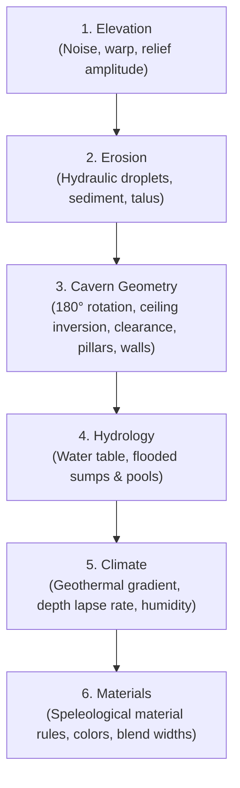

# Plan: Configurable Stages and Dynamic Form for `cavegen-ui`

Status: proposed.

This plan details how to upgrade `cavegen-ui` to match the stage configuration depth and interactive workflow of `worldgen-ui`:
1. Decomposing cave generation into an incremental 6-stage pipeline (`elevation` → `erosion` → `cavern` → `hydrology` → `climate` → `materials`).
2. Adopting schema-driven form generation directly from `CaveConfig` Pydantic models.
3. Adding staleness tracking and stage-level execution controls (individual **Run** and **Reset** buttons, status badges, timers).
4. Restructuring the `cavegen-ui` screen layout into an interactive dual-pane interface (viewport on left, scrollable stage recipe on right).

---

## 1. Motivation and Problem Statement

`worldgen-ui` provides an interactive design workbench where users can inspect and tweak every stage of terrain synthesis. Each section of `TerrainConfig` is mapped to an editable form block with:
- Granular controls (noise frequency, octaves, hydraulic droplet counts, talus angles, biome rules).
- Stage-level status indicators (`not run`, `waiting`, `running`, `done 1.4s`, `stale`).
- Individual stage **Run** and **Reset** actions.
- Automatic caching: changing an erosion setting re-runs only erosion and downstream stages, keeping elevation cached.

In contrast, `cavegen-ui` currently exposes only a seed input and three hardcoded sliders (`clearance`, `min_passage`, `water_table`), running generation as an opaque monolith without stage visibility or fine-grained control over noise, erosion, perimeter walls, climate lapse rates, or speleological materials.

---

## 2. Architecture Comparison

```
+-------------------------------------------------------------------------------------------------+
|                                    CURRENT cavegen-ui                                           |
|                                                                                                 |
|  [ Viewport: 2D / 3D Orbit / 3D FPS ]   |  [ Basic Fixed Panel ]                                |
|                                         |   - Seed input                                        |
|                                         |   - 3 Hardcoded Sliders (clearance, passage, water)   |
|                                         |   - [ Run all ] [ Export cave ]                       |
|                                         |                                                       |
|  * Monolithic generation (runs all or nothing)                                                  |
|  * Zero visibility into elevation noise, erosion dynamics, walls, climate, or material rules    |
+-------------------------------------------------------------------------------------------------+
                                                │
                                                ▼
+-------------------------------------------------------------------------------------------------+
|                                    PROPOSED cavegen-ui                                          |
|                                                                                                 |
|  [ Viewport: 2D / 3D Orbit / 3D FPS ]   |  [ Scrollable Recipe Stages ]                         |
|   - Toolbar: 2D/Orbit/FPS, Cutaway      |   ▾ World (grid size, cell size)                      |
|   - Interactive player collision / light|   ▾ Elevation [done 0.12s] [Reset] [Run]              |
|   - Real-time hover readout             |       Noise frequency, octaves, relief amplitude...   |
|   - Status bar                          |   ▾ Erosion [done 0.85s] [Reset] [Run]                |
|                                         |       Droplets, inertia, talus angle, thermal...      |
|                                         |   ▾ Cavern [done 0.05s] [Reset] [Run]                 |
|                                         |       Clearance, ceiling mode, walls, min passage...  |
|                                         |   ▾ Hydrology [done 0.02s] [Reset] [Run]              |
|                                         |       Water table, enabled toggle...                  |
|                                         |   ▾ Climate [done 0.01s] [Reset] [Run]                |
|                                         |       Geothermal gradient, humidity, base temp...     |
|                                         |   ▾ Materials [done 0.04s] [Reset] [Run]              |
|                                         |       Speleological rule cards, colors, conditions... |
+-------------------------------------------------------------------------------------------------+
```

---

## 3. The 6-Stage Cave Pipeline (`src/worldgen/cave/pipeline.py`)

We decompose `generate_cave()` into discrete, cachable stages:



### Stage Specifications

1. **`elevation`**:
   - *Inputs*: `world`, `elevation` section, stage seed.
   - *Computation*: Calls `worldgen.generator.stages.elevation.elevation()`. Generates base floor elevation heightmap $H_{\text{floor}}$ before erosion.
   - *Outputs*: Floor elevation array, land mask.

2. **`erosion`**:
   - *Inputs*: Floor elevation from stage 1, `erosion` section, stage seed.
   - *Computation*: Calls `worldgen.generator.stages.erosion.erosion()`. Runs hydraulic droplets and thermal slope settling on the cave floor.
   - *Outputs*: Eroded floor elevation array, sediment depth, water accumulation.

3. **`cavern`**:
   - *Inputs*: Eroded floor elevation from stage 2, `cavern` section.
   - *Computation*:
     - Rotates floor heightmap by 180°: $H_{\text{rot}}[z, x] = H_{\text{floor}}[N-1-z, M-1-x]$.
     - Computes ceiling heightmap $H_{\text{ceiling}}$ based on `ceiling_mode` (`"inverted"` vs `"offset"`) and `ceiling_scale`.
     - Computes vertical clearance $\Delta H(x, z) = H_{\text{ceiling}} - H_{\text{floor}}$.
     - Identifies pillar cells where $\Delta H(x, z) < \text{min\_passage}$.
     - Enforces perimeter boundary rock walls if `perimeter_wall` is true.
   - *Outputs*: Final floor elevation, ceiling elevation, clearance grid $\Delta H$, `pillar_mask`.

4. **`hydrology`**:
   - *Inputs*: Floor elevation and cavern clearance from stage 3, `hydrology` section.
   - *Computation*: Identifies subterranean pools where $H_{\text{floor}} \le \text{water\_table}$ and cell is passable ($\neg \text{pillar}$).
   - *Outputs*: Subterranean water elevation grid, sump mask, surface water depth.

5. **`climate`**:
   - *Inputs*: Floor elevation from stage 3, water mask from stage 4, `climate` section.
   - *Computation*: Calculates depth below reference datum, applies geothermal lapse rate ($T = T_{\text{base}} + z_{\text{depth}} \cdot \text{gradient}$), and computes subterranean relative humidity.
   - *Outputs*: Temperature grid (°C), humidity grid (0–1).

6. **`materials`**:
   - *Inputs*: Floor & ceiling elevations, slope, relief, water mask, moisture, temperature, `materials` section.
   - *Computation*: Matches speleological material rules (`sump`, `flowstone`, `limestone`, `fungal_grotto`, `crystal_vault`) and blends surface vertex colors.
   - *Outputs*: Material assignment grid, floor vertex colors, ceiling vertex colors.

---

## 4. Recipe Model and Live Validation (`src/worldgen/cave/ui/model/recipe.py`)

To allow live editing in the UI without crashing on transient invalid inputs (e.g. typing a partial float or invalid range):
- **`CaveRecipe`**:
  - Maintains `data: dict` reflecting the active draft.
  - Validates against `CaveConfig` on each change (`validate()`).
  - Stores `problems: dict[str, list[str]]` mapping YAML paths to error messages.
  - Supports `get(path)`, `set(path, value)`, `toggle(path, on)`, and `reset_section(section_name)`.
  - Serializes cleanly back to YAML or JSON on export.

---

## 5. Schema-Driven Form Generation (`src/worldgen/cave/ui/model/form.py`)

We reuse the battle-tested reflection engine from `worldgen.ui.model.recipe.form` to automatically inspect `CaveConfig`:

### Field Specification Mapping
- Hidden fields: `("version", "client")`.
- `SectionSpec` for each section:
  - `world`: `WorldSection` (grid sizes, cell scale).
  - `elevation`: `ElevationSection` (noise octaves, frequency, relief amplitude, terraces).
  - `erosion`: `ErosionSection` (droplet count, inertia, talus angle, thermal iterations).
  - `cavern`: `CavernSection` (clearance, ceiling mode dropdown, ceiling scale, min passage, perimeter wall toggle, wall thickness).
  - `hydrology`: `CaveHydrologySection` (enabled toggle, water table elevation).
  - `climate`: `CaveClimateSection` (temperature base, geothermal gradient, ambient humidity).
  - `materials`: `BiomesSection` (blend width, relief radius, speleological material rule cards with color swatches and predicate matching).

### UI Components per Field Type
- Numeric fields with bounds: text boxes with stepper snap buttons (`+` / `-`).
- Booleans: check boxes or toggles.
- Literals (e.g. `Literal["inverted", "offset"]`): dropdown selection.
- Color triples (`(R, G, B)`): color preview swatch + channel steppers.
- Material rules (`list[BiomeRule]`): collapsible cards with reordering arrows, condition builders, and delete/add buttons.

---

## 6. Incremental Session & Staleness Engine (`src/worldgen/cave/ui/model/cave_session.py`)

### Staleness Tracking via Hash Chaining
Each stage computes an input hash $K_i$:
$$K_i = \text{hash}(\text{seed}, \text{config}_i, K_{i-1})$$
- If a user edits an `erosion` parameter:
  - `elevation` input hash is unchanged $\rightarrow$ remains **`DONE`** (no recomputation needed).
  - `erosion` input hash changes $\rightarrow$ marked **`STALE`**.
  - All subsequent stages (`cavern`, `hydrology`, `climate`, `materials`) depend on $K_{\text{erosion}}$ $\rightarrow$ automatically marked **`STALE`**.

### Execution Options
- **Run Stage $i$**: Executes only up to stage $i$, allowing the user to inspect intermediate states (e.g. inspecting the eroded floor before ceiling synthesis).
- **Reset Stage $i$**: Reverts section $i$ to default recipe values and marks stage $i$ and downstream stale.
- **Run All**: Executes the entire stale pipeline sequentially on a background worker thread.
- **Interruptibility**: Worker thread checks cancellation tokens between stages and steps, ensuring smooth UI frame rates.

---

## 7. Dual-Pane UI View (`src/worldgen/cave/ui/view/cave_screen.py`)

### Layout
```
+-------------------------------------------------------------+------------------------------------+
| [ 2D Plan ] [ 3D Orbit ] [ 3D FPS ]  [✓ Cutaway] [✓ Light]  | Cave Recipe                  [Run] |
+-------------------------------------------------------------+------------------------------------+
|                                                             | ▾ World                            |
|                                                             |     cell_size: [ 1.0 ]             |
|                                                             |     size_cells: [ 64 ]             |
|                                                             | ▾ Elevation         [done] [↺] [▶] |
|                                                             |     frequency: [ 0.03 ]            |
|                                                             |     max_height: [ 30.0 ]           |
|                     VIEWPORT CANVAS                         | ▾ Erosion           [done] [↺] [▶] |
|            (Raylib Texture: 2D map or 3D GL)                |     droplets: [ 50000 ]            |
|                                                             | ▾ Cavern            [done] [↺] [▶] |
|                                                             |     clearance: [ 18.0 ]            |
|                                                             |     ceiling_mode: [ inverted  ▾ ]  |
|                                                             |     min_passage: [ 2.0 ]           |
|                                                             | ▾ Hydrology         [done] [↺] [▶] |
|                                                             |     water_table: [ -2.0 ]          |
|                                                             | ▾ Climate           [done] [↺] [▶] |
|                                                             |     geothermal: [ 0.025 ]          |
|                                                             | ▾ Materials         [done] [↺] [▶] |
|                                                             |     [flowstone] [sump] [limestone] |
+-------------------------------------------------------------+------------------------------------+
| Status: Settled (all stages up to date)    Hover: x=12.4m, z=8.2m, Floor=4.2m, Ceiling=22.1m    |
+--------------------------------------------------------------------------------------------------+
```

### Event Flow & Controller Coordination
1. User changes a field in the form $\rightarrow$ `CaveController.handle(Event)` updates `CaveRecipe`.
2. Controller updates `CaveSession`: affected stages become `STALE`.
3. If auto-run is active (or user clicks **Run** / **Run All**):
   - Background worker executes only stale stages.
   - When stage 3 (`cavern`) finishes, mesh builder updates 3D floor and ceiling geometry on the worker thread.
   - On completion, main thread uploads meshes to GPU (`CaveRenderer.update_meshes()`) without dropping frame rate.
   - Hover readout and 2D clearance texture refresh automatically.

---

## 8. Implementation Steps

### Phase 1: Pipeline & Incremental Stage Runner
- [ ] Create `src/worldgen/cave/pipeline.py`: define `CaveStage`, `CaveProgress`, `CAVE_STAGES`, and incremental execution functions.
- [ ] Refactor `src/worldgen/cave/generator.py` to use `pipeline.py` internally while maintaining backward-compatible `generate_cave()`.

### Phase 2: Recipe Draft & Form Builder
- [ ] Implement `src/worldgen/cave/ui/model/recipe.py` (`CaveRecipe`): live dict editing, validation error tracking, and YAML path reporting.
- [ ] Implement `src/worldgen/cave/ui/model/form.py` (`cave_recipe_form()`): construct `SectionSpec` and `FieldSpec` trees for all `CaveConfig` sections.

### Phase 3: Staleness Engine & Session Upgrade
- [ ] Upgrade `src/worldgen/cave/ui/model/cave_session.py`:
  - Hash-chaining stage inputs.
  - Per-stage state (`NOT_RUN`, `QUEUED`, `RUNNING`, `DONE`, `STALE`, `FAILED`).
  - Stage execution methods (`run_stage()`, `run_all()`, `reset_stage()`, `stop()`).

### Phase 4: Full Form UI & View Integration
- [ ] Implement `src/worldgen/cave/ui/view/stages.py`: render expandable stage blocks with status badges, reset arrows, and run buttons.
- [ ] Update `src/worldgen/cave/ui/view/cave_screen.py`: split into left viewport picture and right scrollable recipe form.
- [ ] Update `src/worldgen/cave/ui/controller.py`: handle form widget events, section toggling, stage run/reset triggers, and background worker polling.

### Phase 5: Verification & Testing
- [ ] Unit tests for `CavePipeline` stage execution and intermediate outputs (`tests/cave/test_cave_pipeline.py`).
- [ ] Tests for `CaveRecipe` validation, error reporting, and default reset (`tests/cave/test_cave_recipe.py`).
- [ ] Tests for form generation and widget tree layout with all sections expanded (`tests/cave/test_cave_form.py`).
- [ ] UI event handling tests for stage run/reset and field modifications (`tests/cave/test_cave_ui.py`).
- [ ] Verify zero regressions in core `worldgen` tests (`uv run pytest -q`).
- [ ] Ensure 100% clean linting (`uv run ruff check src tests`).

---

## 9. Non-Functional Constraints

- **Zero Modifications to Core Code**: Keep `src/worldgen/generator/`, `src/worldgen/ui/`, `src/worldgen/viewer/` untouched.
- **Determinism**: The same seed and recipe must produce byte-identical cave meshes and bundle outputs regardless of whether stages run all at once or incrementally.
- **Headless Safety**: All UI and OpenGL components must cleanly guard against headless testing environments (`rl.is_window_ready()`).
